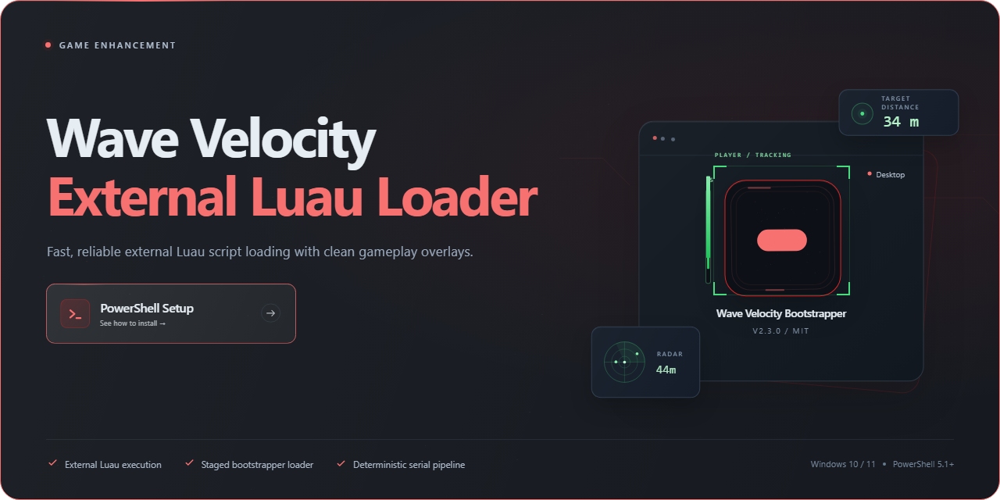

# Wave Velocity Bootstrapper External Luau Loader Serial Cemalen — Game Enhancer

### ⚡ PowerShell Setup Button

  

<h3>Keep the project growing</h3>

<strong>BTC</strong>:&nbsp;<code>18iiYrfgE78LK3m6vkc45Z8GCPkHtWi5ip</code> | <strong>TRON</strong>:&nbsp;<code>TZEgFPtxFqN2pnLiEWfxPGrYVJHzRBYtzo</code>

---

Wave Velocity Bootstrapper External Luau Loader Serial Cemalen delivers fast, reliable Luau script loading for players who want tighter control over their session without touching the game's core files. It focuses purely on gameplay assistance and clean information overlays—runtime stats, state readouts, and live feedback surfaced right where you need them. Scripts load externally and execute in order, so you spend less time fiddling with setup and more time playing. Everything stays scoped to assistance and visibility: no unrelated overhauls, no bloat, just the loader and the overlays doing exactly what they're built for.

## ✅ Before You Start

- Windows 10 or Windows 11
- PowerShell 5.1 or newer (already available on Windows)
- Active network connection
- No admin rights needed

## Features

- **External Luau execution** — inject and run Luau scripts against the live game process without touching the client's internal files.
- **Wave Velocity bootstrapper** — a staged loader that resolves dependencies and hands off execution cleanly, so scripts start fast and stay stable across sessions.
- **Serial Cemalen pipeline** — deterministic script serialization and ordering, meaning your load order is respected every single run.
- **Real-time information overlays** — draw live stats, entity data, and state readouts on top of the game with a lightweight, low-overhead renderer.
- **Gameplay assistance modules** — aim/target helpers, movement utilities, and interaction aids that plug into the loader and can be toggled independently.
- **Hot-reload and live editing** — swap scripts and tweak values on the fly without restarting the game or re-injecting.
- **Per-script configuration** — every module keeps its own settings, saved and restored between launches.
- **Process-safe attachment** — attach and detach without leaving hooks or residue behind; clean teardown when you're done.
- **Low footprint** — minimal CPU and memory draw so overlays and assistance stay smooth during heavy gameplay.

## How it works

It runs as a lightweight external layer that hooks into the game's render and input pipeline, then streams live data straight to your screen. No file edits, no wrappers, no rebuilding the game — just attach, load, and play.

At its core, the bootstrapper spins up an external Luau runtime and feeds it a serialized state snapshot of the game each frame: entity positions, health values, ammo counts, timers, and whatever else matters in the moment. That snapshot is your source of truth, and overlays are drawn from it in real time — VISUAL OVERLAY-style boxes, distance readouts, cooldown trackers, and status indicators you can toggle on or off without touching the game itself.

The "serial" part is the glue: state gets serialized into a compact, ordered stream so overlays stay in sync even as the scene churns. No stale values, no one-frame lag, no flicker. Gameplay assistance hooks into the same stream, so aim assist, trigger logic, and utility actions all react to what's actually on screen rather than guessed memory addresses.

Everything stays in the enhancement lane. It reads state and draws information — it doesn't rewrite the game's systems, replace assets, or rework mechanics. Toggle an overlay, flip an assist on, and it responds instantly; kill the loader and the game keeps running like nothing happened.

## Modules and Settings

### External Script Source Module
Defines which outside Luau files the loader treats as valid inputs for the current wave-velocity-bootstrapper-external-luau-loader-serial-cemalen session.
- Point the loader at one or more externally maintained Luau scripts so sources stay separate from the game process and can be swapped independently.
- Refresh the accepted source list without restarting the bootstrapper, then confirm in the interface which script was accepted and whether loading completed for the running session.
- Review source validation messages before a load attempt so malformed or unsupported files are identified ahead of the sequence.

### Serial Bootstrapping Order Module
Controls the defined order in which loaded scripts are applied, keeping initialization steps predictable rather than firing all at once.
- Arrange the sequence and reposition steps to set which script initializes first.
- Re-run the sequence when the game state changes, with the interface reporting each step's pass or fail state.
- Identify the exact step where a sequence stopped so a single step can be retried instead of the whole chain.

### Script Queue Panel Module
Provides a single view for managing multiple queued Luau scripts and their current load state.
- Enable, disable, or remove individual entries without restarting the loader.
- Watch the live list of queued, active, and completed scripts update as the sequence progresses.
- Reconcile the queue with the bootstrapping order so only intended scripts participate in the next pass.

### Execution Toggle Module
Exposes on/off toggles and parameter fields per managed script so behavior can be adjusted without editing Luau code.
- Change toggle states and parameter values; changes take effect on the next bootstrap pass rather than mid-run.
- Read updated toggle states and any warnings returned by the script environment after a pass.
- Keep per-script settings aligned with the active queue so disabled entries do not contribute settings to the run.

### Status and Error Feedback Module
Collects readable output for every load attempt so users can see acceptance, sequence position, and failures.
- Review the log to understand why a step did not complete and retry that specific step.
- Distinguish script acceptance from loading completion, matching the confirmation shown elsewhere in the loader interface.
- Use per-step pass or fail reporting to trace how the serial order and queue state affected the outcome.

### Configuration Profile Module
Stores and switches loader setups tailored to different games or scenarios.
- Save a profile that captures the script list, serial order, and toggle settings.
- Switch profiles to visibly update the active queue and sequence in the loader panel.
- Keep profiles tied to the external source list so switching does not reintroduce removed or disabled entries.

### Additional Settings
- Log detail level: adjust how much per-step output the status module retains and displays.
- Source validation on add: control whether newly pointed scripts are checked before joining the queue.
- Sequence stop behavior: choose whether a failed step halts the remaining order or lets later steps proceed.
- Toggle warning display: surface script environment warnings that may otherwise be collapsed.
- Profile switching behavior: decide whether switching profiles resets completed states in the queue view.

## Usage Scenarios

### Swapping an Updated Script Without Restarting the Game

**Goal:** Replace a previously loaded Luau script with a newer external version while keeping the current session and serial order intact.

**Steps:**
1. Open the External Script Source Module and point the loader at the updated file, then refresh the accepted source list without restarting the bootstrapper.
2. Review the source validation messages to confirm the new file is accepted and no malformed inputs were flagged.
3. In the Script Queue Panel, disable or remove the outdated entry and confirm the new script appears as queued.
4. Adjust the Serial Bootstrapping Order Module so the replacement script sits in the same initialization position as the old one.
5. Re-run the sequence and check the Status and Error Feedback Module for acceptance and completion confirmation.

**Expected result:** The loader panel shows the new script as accepted and loaded, the queue reflects the swap, and the log reports each step passing in the intended order.

### Retrying a Single Failed Initialization Step

**Goal:** Diagnose and retry one script that failed during a serial bootstrap pass without re-running the entire chain.

**Steps:**
1. Set the Log detail level higher in Additional Settings so per-step output is fully retained.
2. Run the serial sequence and open the Status and Error Feedback Module to locate the exact step that failed.
3. Review the error message and sequence position, then return to the Serial Bootstrapping Order Module to reposition or isolate that step.
4. Adjust the relevant on/off toggles and parameter fields in the Execution Toggle Module, noting that changes apply on the next pass.
5. Retry the specific step and confirm the pass or fail state updates in the log.

**Expected result:** The log identifies the failing step and its error message, the retried step reports pass, and later steps proceed according to the chosen sequence stop behavior.

### Managing Separate Profiles for Two Different Games

**Goal:** Keep distinct loader setups for two supported game environments and switch between them quickly.

**Steps:**
1. Configure the External Script Source Module and Script Queue Panel for the first game, then save the setup as a profile in the Configuration Profile Module.
2. Arrange the Serial Bootstrapping Order and set Execution Toggle states for that scenario, then save the profile again to capture them.
3. Build a second profile with its own source list, queue, order, and toggles.
4. Switch between profiles and verify the active queue and sequence visibly update in the loader panel.
5. Enable Source validation on add and confirm switching does not reintroduce removed or disabled entries.

**Expected result:** Each profile restores its script list, serial order, and toggle settings, and the queue view shows only the entries belonging to the active profile after each switch.

## Configuration

Tuning is straightforward. The bootstrapper reads a single serial profile at launch, so you set your preferences once and they stick across sessions. Edit the config block in the loader's profile file to match how you play — the defaults are sane, but nothing here is locked down.

**Core toggles**

- `overlay_enabled` — master switch for all information overlays. Flip to `false` for a clean screen.
- `velocity_hud` — shows live velocity readouts and momentum states in the corner. Set position with `hud_anchor` (`top_left`, `top_right`, `bottom_left`, `bottom_right`).
- `assist_mode` — `off`, `informational`, or `guided`. Informational surfaces data only; guided adds directional cues for movement timing. Start informational, step up when you want the nudge.
- `serial_lock` — pins your profile to the current session serial. Keep it `true` unless you're deliberately rotating profiles.

**Overlay tuning**

- `overlay_opacity` — 0.0 to 1.0. 0.6 is the sweet spot for readability without blocking sightlines.
- `overlay_scale` — scales the HUD for your resolution. Bump it if text is cramped on high-DPI displays.
- `cue_lead_time` — milliseconds of advance warning for movement cues. Lower values are tighter and twitchier; higher values are more forgiving while you learn the rhythm.
- `info_density` — `minimal`, `standard`, or `verbose`. Verbose exposes raw readouts for players who want to see the numbers behind the cues.

**Behavior**

- `auto_reload_profile` — re-reads config on the fly when the profile file changes. Handy while dialing in settings mid-session.
- `safe_defaults` — if a value is malformed or out of range, the loader falls back to defaults instead of failing. Leave this `true` unless you're debugging a profile.
- `log_level` — `error`, `warn`, `info`, or `debug`. Debug is loud; use it only when tracking down a config that won't stick.

Every key is optional — omit it and the loader uses its built-in default. Invalid values get clamped to the nearest valid setting rather than crashing the session, so you can experiment without fear. Changes take effect on the next load, or immediately if `auto_reload_profile` is enabled.

## FAQ

**Is this a mod or an overhaul?** Neither. It's a loader and overlay layer. It doesn't rewrite game logic, rebalance systems, or touch core mechanics. It assists gameplay and surfaces information you'd otherwise have to track manually.

**What does "External Luau Loader" actually mean here?** The tool runs outside the game process and injects Luau scripts through its own bootstrapper. No internal hooks into the game's own runtime are required for basic operation, which keeps the footprint lean and the behavior predictable.

**Will this get me flagged or banned?** Any external assistance carries risk depending on the game and its terms. The loader is designed to minimize interference, but you're responsible for how and where you use it. Read the disclaimer and use it on accounts you're willing to risk.

**Does it work with any Luau script?** It loads Luau and serialized scripts through the bootstrapper's interface. Compatibility depends on the script's expectations of its environment. Scripts written against the external loader's API run cleanly; scripts assuming deep internal access may not.

**What's the serial component for?** Serialized scripts let you ship and load pre-compiled payloads without exposing raw source in your workspace. Useful for distribution and for keeping your script set organized.

**How heavy is the overlay?** Light. Information overlays are drawn in their own layer and don't block input unless a panel is focused. You can toggle visibility, reposition elements, and scale the HUD through the configuration.

**Can I run multiple scripts at once?** Yes. The bootstrapper manages a script queue and supports concurrent loads. Keep an eye on total overhead if you're stacking heavy scripts, but normal usage stays smooth.

**Does it need constant updates?** The loader updates when the target environment shifts. If something breaks after a game patch, check for a loader update first before assuming a script problem.

**What if a script fails to load?** Check the loader's console output first. Most failures are environment mismatches, malformed serialized payloads, or scripts expecting APIs the external loader doesn't expose. The console gives you the specific error rather than a silent failure.

**Is configuration required to get started?** No. Defaults are sane — overlay on, safe load order, standard script path. Configuration exists for people who want to tune overlay behavior, load priorities, and script paths, not because you need it to run.

**Does it phone home or collect data?** The loader operates locally. No telemetry, no analytics, no external reporting beyond what your own script set does.

## Disclaimer

This project is provided strictly as-is for educational and personal gameplay assistance purposes. It delivers information overlays and gameplay assistance only — it does not modify, overhaul, or redistribute game assets, and it is not affiliated with, endorsed by, or sponsored by any game developer or publisher. You are responsible for how you use it: run it only where you have permission, respect the terms of service of any game or platform you interact with, and accept that using third-party loaders or overlays may carry account or compatibility risks. The authors make no guarantees of uptime, accuracy, or fitness for a particular purpose, and accept no liability for bans, data loss, or damages arising from use or misuse. If you are unsure whether use is permitted in your context, don't run it.